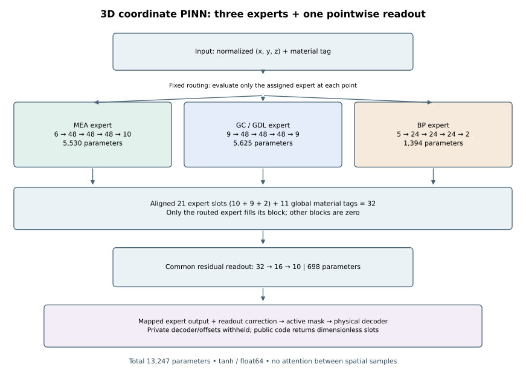

# PEMFC 영역별 PINN — 중간 결과와 원인 분석

**전체 PEMFC 물리장을 정확하게 재현한 수렴 해를 얻지는 못했다.**
시도한 모델, 남은 오차, 원인 분석과 짧은 대조 실험을 정리한 연구 기록이다.
[English](README.md) · [상세 결과](results/interim/report.md)

- 실제 초기 물리학습 경로의 40회 추가 학습에서 고정 표본 PDE loss는 97.97%
  줄었지만 validation 정규화 MSE는 1.26% 증가했다.
- 별도의 데이터 전용 200회 모델에서 시작한 A/B 각 10회는 다른 학습 계보다.
  A는 원래 물리 잔차를 더 줄였지만 데이터 오차가 커졌고, B는 데이터 재현을
  보존했지만 N2 계면 flux 불일치 감소가 작았다. 최종 방법을 선택하지 않았다.
- 데이터 전용 200회 기준 CFD 대비 상대 L2 오차: 막 전위 29.68%, CCL 산소
  44.00%, 음극 채널 속도 벡터 50.86%. 정규화 loss를 %로 바꾼 것이 아니다.

실제 대상은 3D다. MEA, 채널·GDL, BP를 담당하는 MLP 3개와 공통 출력 MLP 1개,
총 13,247개 파라미터를 사용했다. 공통 출력은 위치별로 작동하며 attention이 아니다.

원본 CFD/UDF, 격자, 공간장, 체크포인트와 전사한 물성·소스·디코더는 공개하지 않는다.
공개 코드는 독립 작성한 일반 네트워크·학습 루프와 합성 3D 확산 예제다.
합성 예제 실행은 실제 PEMFC 실험의 재현이 아니다.

    python -m pip install -e ".[test]"
    python -m pytest
    python examples/train_synthetic.py --device cpu --warmup 20 --physics 20

이번 정리에서 로컬 Torch 학습·추론은 실행하지 않았다. [검증 상태](docs/verification.md).
2026-10-25는 문서 정리일이며 이전 구상, 실제 구현·실험, GitHub 게시를 구분한다.
이전 구상의 정확한 시작일은 당시 기록 없이 확정하지 않는다. [이력](docs/history.md).
AC·CC 유속·압력 고정은 다음 설계로, 여기의 실험 결과에 적용되지 않았다.
