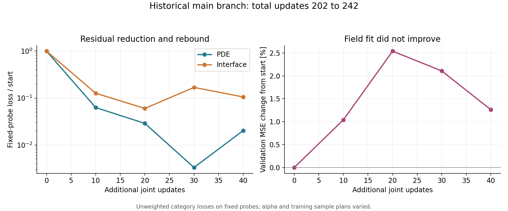
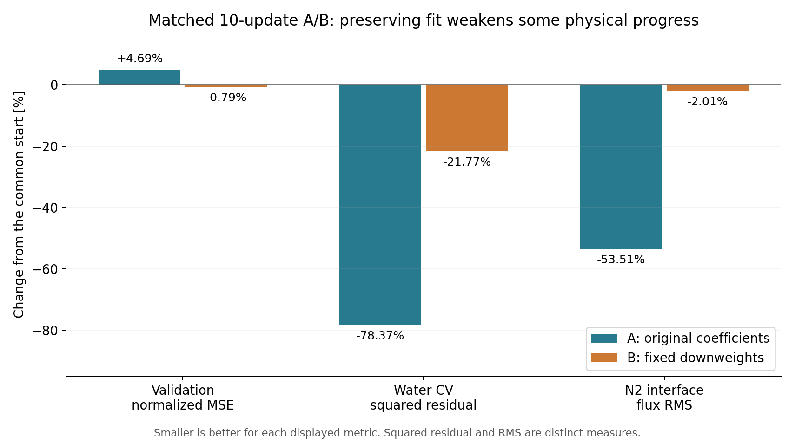

# PEMFC Domain PINN — interim results and diagnostic study

**Status: the coupled PEMFC experiments have not converged to an accurate full-field solution.**
This repository documents the attempted model, fields that remained inaccurate,
and diagnostics that distinguish residual reduction from reconstruction quality.

[한국어](README.ko.md) · [Detailed results](results/interim/report.md) ·
[Architecture](docs/architecture.md) · [Training](docs/training.md) · [Cause diagnostics](docs/diagnostics.md) ·
[References](docs/references.md) · [History and dates](docs/history.md)

## Results first

In the main 40-update continuation, fixed-probe PDE loss fell **97.97%** from its
starting value, while validation normalized MSE rose **1.26%**. PDE loss also
rebounded **6.11 times** between the last two fixed evaluations. Membrane
potential error barely changed. Lower residuals did not establish accurate fields.

A separate matched A/B experiment started from a **data-only 200-update control**:

| Metric | Common start | A: original coefficients, 10 updates | B: fixed downweights, 10 updates |
|---|---:|---:|---:|
| Validation equal-tag normalized MSE | 0.00878934 | 0.00920152 | 0.00871972 |
| Membrane proton-potential error RMS [mV] | 10.8197 | 10.8223 | 10.6989 |
| Cathode CL oxygen mass-fraction error RMS [kg/kg] | 0.0365647 | 0.0369854 | 0.0363245 |
| Cathode-channel water CV squared residual | 1,302,833 | 281,825 | 1,019,266 |
| Cathode CL–membrane N2 flux mismatch RMS [kg/(m² s)] | 1.48527 | 0.690562 | 1.45535 |

A reduced original physical residuals more strongly but degraded the data fit.
B largely preserved the fit but reduced N2 flux mismatch by only **2.01%**.
Neither branch is a converged solution or an established best method.

The data-only control was already underfit: validation relative L2 errors were
**29.68%** for membrane proton potential, **44.00%** for cathode CL oxygen and
**50.86%** for cathode-channel velocity. These percentages are for that control,
not the historical 242-update branch. [Metric definitions](docs/evaluation.md).

## Research question and background

Can a small coordinate-based network represent coupled 3D flow, heat, species,
water and charge transport across the different regions of a polymer electrolyte
membrane fuel cell? Reducing a scalar loss is insufficient: the fields and
cross-region transfers must improve together under limited Colab compute.

Published physical context includes [GDL compression and intrusion](https://doi.org/10.1149/1945-7111/ac492f)
and [Pt particle-size distributions](https://doi.org/10.1016/j.electacta.2021.139811).
Those publications did not report the later spatial PINN experiments presented here.

## Network

Three deterministic expert MLPs cover MEA, channels plus GDLs, and bipolar plates.
One residual readout maps 21 aligned expert slots plus 11 material tags to 10
output slots: **13,247 parameters**, tanh, float64. Only the assigned expert is
evaluated per point. The common head is pointwise, with no spatial attention.

The private experiment is **3D**, even when displayed as a 2D slice. It is a
single-case data-assisted PINN study, not demonstrated operator learning.

## Public training code

Independent public code implements the expert/readout topology, generic
differentiation, four-category loss accumulation, Adam and checkpointing.
An **11-slab manufactured 3D diffusion example** exercises these pieces without
private CFD files. It is not a fuel-cell model or a reproduction of the metrics.

    python -m pip install -e ".[test]"
    python -m pytest
    python examples/train_synthetic.py --device cpu --warmup 20 --physics 20

GPU option: --device cuda. The [Colab notebook](notebooks/synthetic_demo.ipynb)
runs verification before the example. Public Torch code was **not executed**
locally during packaging. [Verification status](docs/verification.md).

| Public | Withheld |
|---|---|
| Architecture and methodological explanation | Mesh, cell/face fields and CFD contours |
| Generic training code and synthetic demo | UDF-transcribed properties, sources and lookup tables |
| References and limitations | Checkpoints, private decoder and case configuration |

Exact historical PEMFC reproduction is unavailable from this repository alone.
See [data availability](DATA_AVAILABILITY.md) and [code correspondence](docs/code-correspondence.md).

## Next design, not a reported result

Supplying CFD velocity and pressure in both channels was selected for subsequent
design. Interface mass-transport/density consistency remains unresolved; no
result with this change is reported. MultiAdam and Transformer replacements
were discussed, not implemented in these experiments.

Documentation prepared **2026-10-25**. This is not the inception date of the
concept or an inferred date for every experiment. [History](docs/history.md).
Git commits are not backdated.

Maintainer: Yohan Cha. Preparation and independent public code used AI assistance.
No blanket open-source license is assigned in this snapshot. [License status](LICENSE.md).
